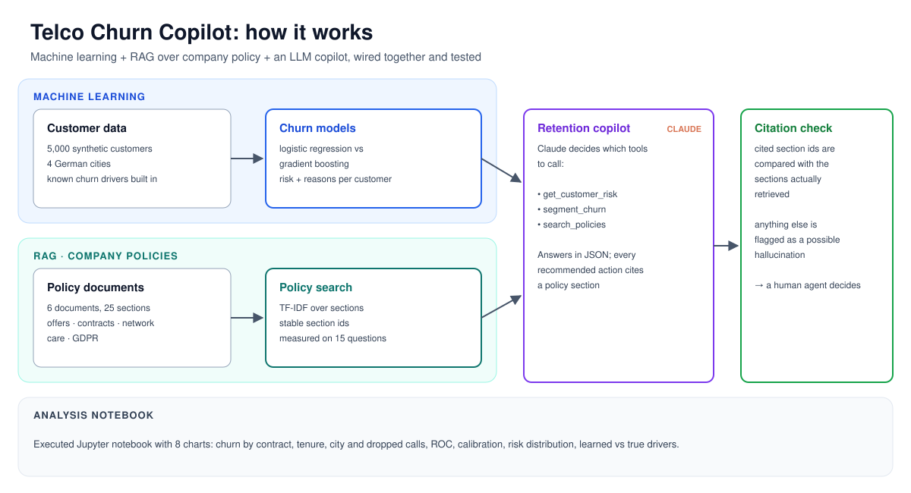
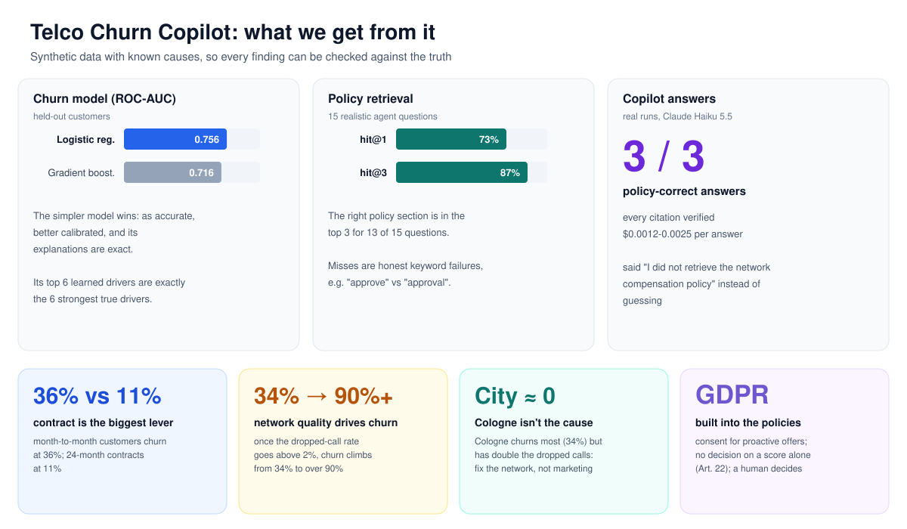
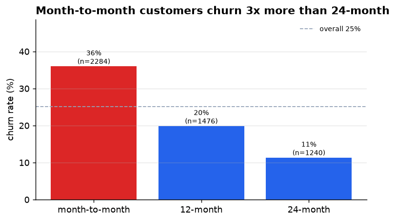
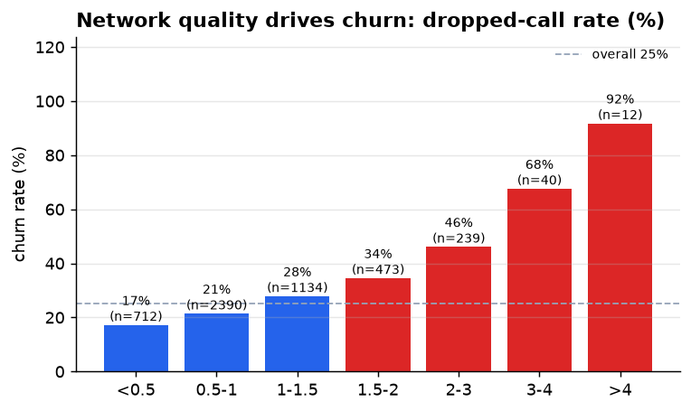
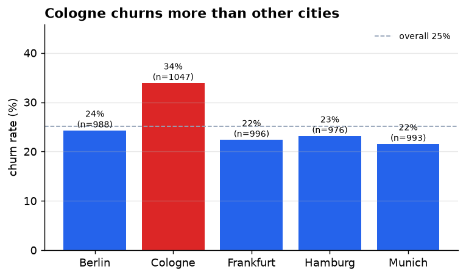
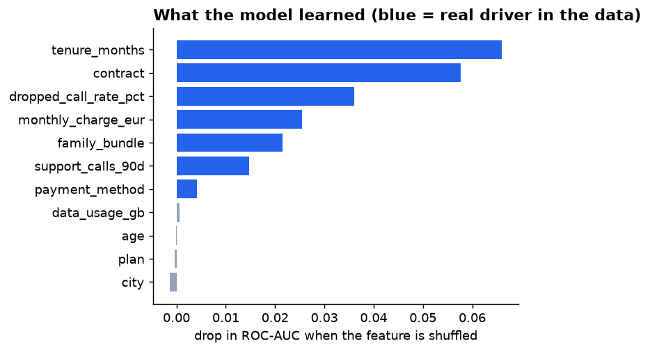
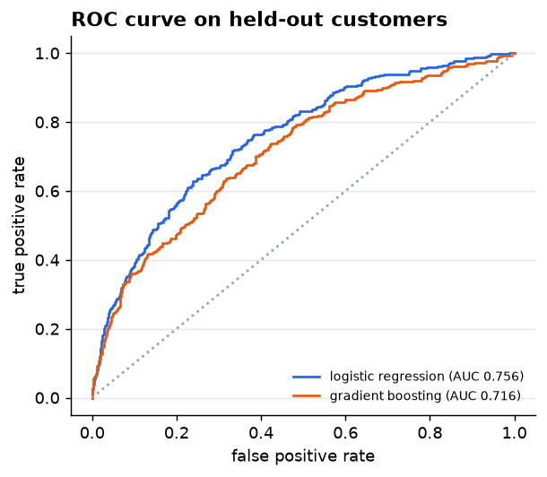
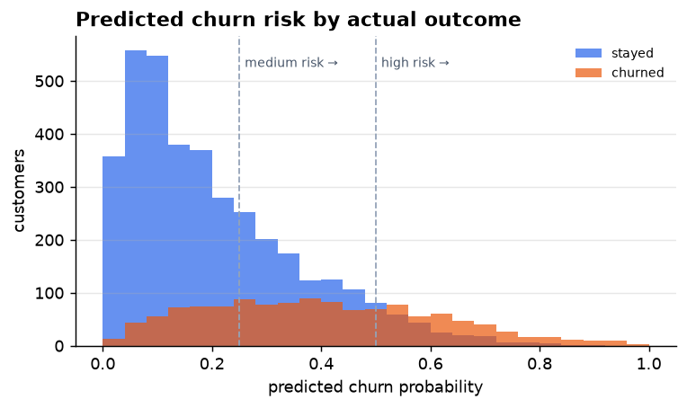

# 📶 Telco Churn Copilot: ML + RAG + LLM for customer retention

**Predict which mobile customers are about to leave, explain why, and tell the retention agent exactly what the company policy allows them to offer, with citations that are checked.**


> Built by a telecom SDET moving into AI engineering. Three pieces most "churn demo" projects keep separate (machine learning, retrieval over company documents, and an LLM), wired together and **tested**.

---

## How it works



A retention agent asks: *"Customer C-04124 says they want to leave. What can we offer?"*
The copilot calls the **churn model** (99.7% risk; drivers: 5.9% dropped calls, 7 support calls, month-to-month contract), **searches the policies** (network-quality cases need a ticket and compensation *before* any discount; above 4% dropped calls the customer may leave without notice), and answers with actions that each cite a policy section. **Any citation to a section it never retrieved is flagged** as a possible hallucination.

## What we get from it



## Copilot answers (real runs, Claude Haiku 5.5)

| Question | What the policy requires | Copilot | Cost |
|---|---|---|---|
| *C-04124 wants to leave. What can we offer?* (5.9% dropped calls) | Network first: ticket + €20 credit (>4% dropped calls); customer may leave without notice; discounts second | ✅ all of it, in that order | $0.0025 |
| *What retention offer for C-00005?* (medium risk, Basic 10GB) | 10% off for 6 months **or** 10 GB add-on, add-on preferred for Basic; 20% is high-risk only | ✅ add-on first, 20% ruled out | $0.0012 |
| *Can we call all high-risk customers this week with 20% off?* | No blanket campaign: marketing consent, one offer per 12 months, human review, 20% only with a longer contract | ✅ "Not as a blanket campaign", then each rule | $0.0012 |

All citations in all three answers were verified against what was actually retrieved. In the third answer the copilot also said *"I did not retrieve the network compensation policy, so I cannot give its terms"* instead of guessing.

<details>
<summary>Full answer for C-04124 (tool trace + cited actions)</summary>

```text
  turn 1: get_customer_risk({"customer_id": "C-04124"})
  turn 1: search_policies({"query": "customer retention offers for customers wanting to cancel"})
  turn 1: search_policies({"query": "retention discount eligibility limits approval"})
  turn 2: search_policies({"query": "network quality compensation dropped calls network investigation ticket"})
  turn 3: search_policies({"query": "network-quality compensation amount credit per customer"})

13557+2353 tokens, 18.34s, $0.0025

C-04124 is high risk (churn probability 0.997). The main drivers are a 5.91% dropped-call rate, 7 support
calls in 90 days, and a month-to-month contract. Because the main driver is network quality (dropped-call
rate above 2%), policy says not to lead with a discount. Start with a network investigation ticket and
network-quality compensation: €20 because the rate is above 4%. At that level the customer may also leave
the month-to-month contract with no notice period ...

  • Open a network investigation ticket for Cologne with the measured rate (5.91%) and time period
    [network-compensation#network-investigation-ticket]
  • Offer the one-off €20 network-quality credit (dropped-call rate above 4%)
    [network-compensation#compensation-amounts]
  • Lead with the network fix, not a discount
    [retention-offers#offers-when-network-quality-is-the-driver]
  • If the customer commits, 20% off for 12 months with a 12/24-month contract; otherwise max 10% for 6 months
    [retention-offers#offers-for-high-risk-customers]
  • Do not promise a fix date; check whether the 7 calls trigger escalation
    [customer-care-escalation#escalation-path]

Citation check: every citation was actually retrieved ✓
```
</details>

## Data analysis (notebook)

The full analysis is in [`notebooks/churn_analysis.ipynb`](notebooks/churn_analysis.ipynb), executed with outputs, so it renders on GitHub.

| | |
|---|---|
|  |  |
|  |  |

**Findings:**
- **Contract type is the biggest lever:** month-to-month customers churn at 36% vs 11% on 24-month contracts.
- **Network quality drives churn:** above a 2% dropped-call rate, churn climbs from 34% to over 90%.
- **Cologne churns more (34%), but city is not the cause.** Cologne has roughly double the dropped-call rate. Once network quality is in the model, city's importance drops to about zero. Fix the network, not the marketing.
- **The model learned the real drivers.** The data is generated from known effects, so explanations can be *verified*: the top six learned features are exactly the six strongest true drivers.

## Models

| Model | ROC-AUC | PR-AUC | Brier (lower is better) |
|---|---|---|---|
| **Logistic regression (deployed)** | **0.756** | **0.524** | **0.157** |
| Gradient boosting (challenger) | 0.716 | 0.487 | 0.173 |

| | |
|---|---|
|  |  |

The simpler model wins. The true churn process is close to logistic, so boosting has nothing extra to find and overfits slightly. Logistic regression is deployed because it is as accurate, better calibrated, and its per-customer explanations are exact (coefficient × standardised value), which matters when an agent has to justify an offer.

## RAG: retrieval you can measure

Policies are split into 25 sections with stable ids (e.g. `retention-offers#offers-for-high-risk-customers`) and ranked with TF-IDF. Retrieval is evaluated on 15 realistic agent questions ([`eval/rag_questions.json`](eval/rag_questions.json)):

| Metric | Score |
|---|---|
| hit@1 (right section ranked first) | **73%** (11/15) |
| hit@3 (right section in the top 3) | **87%** (13/15) |

The misses are honest keyword-search failures, such as "*approve* a 30% discount" vs a policy that says "*approval*", or "call customers *proactively*" vs "*marketing consent*". The agent sees the top 4 sections and can search again with other words. Swapping in dense embeddings is a one-class change, and the eval set will show whether it helps.

## Responsible AI

- **GDPR built into the knowledge base:** proactive offers need marketing consent; a churn score is never the only basis for a significant decision (Art. 22); age and city must not set offer amounts.
- **Human in the loop:** the copilot recommends; a retention agent decides.
- **Citation check:** every recommended action must cite a policy section that was actually retrieved in that conversation.
- **Synthetic data only:** no real customer or operator data.

## Quick start

```bash
git clone https://github.com/abpandey-dev/telco-churn-copilot.git && cd telco-churn-copilot
python -m venv .venv && source .venv/bin/activate
pip install -e ".[dev]"

churn train                          # metrics + learned vs true drivers
churn customer C-04124               # risk + explanation for one customer
churn search "discount approval"     # search the policies
churn eval-rag                       # retrieval hit@1 / hit@3
pytest -q                            # 11 tests, no API key needed
python scripts/build_notebook.py     # re-run the notebook and regenerate charts
```

LLM copilot (needs `ANTHROPIC_API_KEY`; a question costs about a cent with Haiku):

```bash
churn ask "Customer C-04124 says they want to leave. What can we offer?" --model claude-haiku-5-5 --trace
```

## Project layout

```text
src/churn_copilot/
  data.py        # synthetic customers with known churn drivers
  model.py       # logistic regression + gradient boosting, explanations, importance
  rag.py         # policy chunking + TF-IDF retriever
  agent.py       # Claude tool loop: customer risk, segments, policy search; citation check
  viz.py         # charts for the notebook and README
  cli.py         # `churn` command
  knowledge/     # retention, contract, network-compensation, care, GDPR policies + model card
notebooks/       # executed analysis notebook
eval/            # retrieval evaluation questions
tests/           # 11 tests, incl. agent loop with a scripted fake client
```

## Roadmap

- [x] Real copilot answers checked against policy (3 questions, Haiku 5.5)
- [ ] Larger answer-quality eval: LLM-as-judge against policy rules
- [ ] Dense embeddings vs TF-IDF on the retrieval eval set
- [ ] Uplift modelling: who will *respond* to an offer, not just who will churn
- [ ] Streamlit dashboard

---

*Independent personal project. All data and policies are synthetic; not affiliated with any network operator.*
